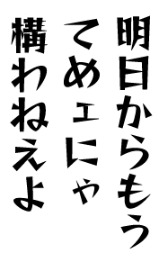
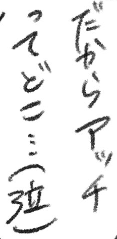
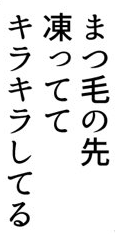
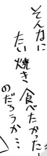
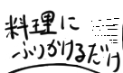
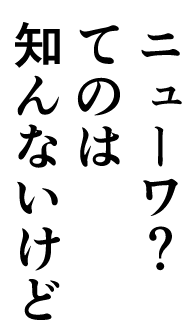
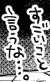

# MangaOCR-Nar-Small

[English](README.md) | [中文](README_zh.md)

[GitHub](https://github.com/muscgab/mangaocr-nar-small) (code and docs only, no weights) · [Hugging Face](https://huggingface.co/muscgab/mangaocr-nar-small) · [ModelScope](https://modelscope.cn/models/muscgab/mangaocr-nar-small)

OCR for Japanese manga text boxes. It takes one cropped text box and outputs the whole text in a single forward pass (non-autoregressive). 54.2M parameters.

- On [JMangaBench_Read v1.3](https://github.com/muscgab/JMangaBench_Read) (7,789 boxes): composite 97.26, CER 1.73%, EM 91.09%.
- RTX 2080 Ti, fp16: 9.1 ms per crop; one page (8.7 boxes on average) as one batch, p50 35.5 ms.
- Three formats: NVIDIA GPU (PyTorch, CUDA graphs), CPU (ONNX), Mac (CoreML, macOS 15 or later).

## Examples

The crops are boxes with human-confirmed labels in [JMangaBench_Read v1.3](https://github.com/muscgab/JMangaBench_Read). They were picked from boxes the model reads correctly and are not representative (see Accuracy for average performance). Outputs are shown exactly as the model produced them.

| Printed | Output | Handwritten | Output |
|---|---|---|---|
|  | 明日からもうてめェにゃ構わねえよ |  | だからアッチってどこ…(泣) |
|  | まつ毛の先凍っててキラキラしてる |  | そんなにたい焼き食べたかったのだろうか… |
|  | 他のノートもあるって、見るかい? |  | 料理にふりかけるだけ |
|  | ニューワ?てのは知んないけど |  | すごいこと言うな…。 |

The images come from works published online by independent artists and are provided with Read under CC BY-NC-SA 4.0. File names are the box IDs in Read.

## Accuracy

[JMangaBench_Read v1.3](https://github.com/muscgab/JMangaBench_Read), batch = 1 outputs, scored with the benchmark's RIN v1 normalization. Reference models: Hayai v2.5 Nova p384 (highest composite of the three Nova variants) and mangaOCR (baseline). See the benchmark page for the full leaderboard.

All 7,789 boxes:

| Metric | MangaOCR-Nar-Small | Hayai v2.5 Nova p384 | mangaOCR |
|---|---|---|---|
| Parameters | **54M** | 157M | 111M |
| Composite ↑ | **97.26** | 96.62 | 90.23 |
| CER % ↓ | **1.73** | 2.40 | 4.84 |
| EM % ↑ | **91.09** | 88.00 | 78.25 |

EM % by subset (↑):

| Subset | Boxes | MangaOCR-Nar-Small | Hayai v2.5 Nova p384 | mangaOCR |
|---|---|---|---|---|
| New in v1.3 | 4,660 | **91.35** | 88.22 | 78.20 |
| Printed | 5,877 | **94.44** | 91.70 | 88.04 |
| Non-printed | 1,912 | **80.81** | 76.62 | 48.17 |
| hard | 784 | **70.92** | 63.39 | 44.52 |

CER % by subset (↓):

| Subset | Boxes | MangaOCR-Nar-Small | Hayai v2.5 Nova p384 | mangaOCR |
|---|---|---|---|---|
| New in v1.3 | 4,660 | **1.64** | 2.29 | 4.80 |
| Printed | 5,877 | **1.24** | 1.84 | 2.21 |
| Non-printed | 1,912 | **4.14** | 5.08 | 17.56 |
| hard | 784 | **7.14** | 8.92 | 16.43 |

The composite is the equal-weight mean of 1 − NED over the printed and non-printed parts; see the benchmark README for the definition.

**Evaluation data used during development**: Read v1.2 (3,142 boxes) was the development set of MangaOCR-Nar-Small and its predecessors, used for model selection, controlled experiments and error analysis. Another development set, "Sol handwriting" (2,248 boxes), shares 1,021 boxes with the boxes new in v1.3 (including 1,004 of the 1,110 new non-printed boxes). No image from the candidate pool or the benchmark was used for training. See "Development use" in the benchmark README.

## Speed

RTX 2080 Ti (11 GB), fp16, 8 CPU cores pinned per model, same method as JMangaBench_Read v1.3. Unit: ms (except throughput).

| Metric | MangaOCR-Nar-Small | Hayai v2.5 Nova p384 | mangaOCR |
|---|---|---|---|
| Per-crop latency, mean | **9.1** | 54.0 | 84.9 |
| Page latency p50 | **35.5** | 252 | 242 |
| Page latency p90 | **63.1** | 321 | 471 |
| Page by page, 0 s gap | **37** | 245 | 288 |
| Page by page, 10 s gap | **53** | 289 | 333 |
| Page by page, 30 s gap | **56** | 282 | 286 |
| First crop, running | **7.5** | 51.5 | 72.6 |
| First crop, after 20 s idle | **24.7** | 81.7 | 93.3 |
| Max throughput (crops/s) | **299** | 175 | 42 |

- Per crop: batch = 1, preprocessing included.
- Page: the boxes of one page as one batch, 8.7 boxes on average.
- Page by page: one request per page, idle for 0 / 10 / 30 s between pages.
- Batch size at max throughput: 48 / 48 / 56.
- The slowdown after idling comes from GPU down-clocking and affects every model.

### Weak GPU

Laptop GTX 1060 Max-Q (6 GB, Pascal, no fast fp16, everything in fp32; CPU i7-8750H, Windows 11). mangaOCR was not measured on this machine.

| Metric | MangaOCR-Nar-Small | Hayai v2.5 Nova p384 |
|---|---|---|
| Per-crop latency p50 (ms) | **25.2** | 115.4 |
| Page by page, 0 s gap (ms) | **160** | 676 |
| Page by page, 10 s gap (ms) | **169** | 759 |
| EM % | **91.09** | 87.80 |

- Per-crop latency and EM: all 7,789 boxes for MangaOCR-Nar-Small (EM same as on the 2080 Ti), 500 boxes for Nova p384.
- Page by page: the same 8 pages, median time per page.

About 0.16–0.19 s per page, so pages can be read while flipping through them on this class of GPU. The MangaOCR-Nar-Small rows above use CPU preprocessing + CUDA graphs; the default GPU-preprocessing path of the release is about 6 ms slower per crop and about 9% slower per page on this card (195 pages, p50 187 ms), while CPU time per crop drops from about 150 ms to about 6 ms.

Other platforms (end to end, incl. preprocessing):

| Format | Device | Time per crop | EM % | Same as CUDA |
|---|---|---|---|---|
| CUDA graphs, fp16 | RTX 2080 Ti | see above | 91.09 | 7,789 |
| ONNX, fp32 | Xeon Gold 6148 | 58.2 ms | 91.09 | 7,788 |
| CoreML, fp16 | M1 Pro GPU | 10.1 ms | 91.05 | 7,778 |

- ONNX: 8 threads, per-crop p50.
- CoreML: multifunction package, macOS 15; time per crop in batches of 16 (preprocessing 2.2 + inference 7.9 ms); page by page p50 102 ms.
- Same as CUDA: boxes (of 7,789) whose output equals the CUDA fp16 output.

## Architecture

- **Encoder**: MonkeyOCRv2-S vision encoder (28.5M), initialized from [zenosai/MonkeyOCRv2-S](https://huggingface.co/zenosai/MonkeyOCRv2-S). It outputs the patch embeddings $h_0$, the layers $h_1 \ldots h_{11}$ and the final layer $h_{12}$.
- **Input**: the crop is resized with its aspect ratio kept and padded to 324 patches of 14 × 14 (PIL bicubic; empty area filled with the median colour of the border).
- **Gamma fusion**: base memory $b = \mathrm{Bridge}(h_{12}) + \mathrm{Pos}(r, c)$. Decoder layer $j$ reads its own memory

$$m_j = b + \gamma_j \odot W_o f_j,\qquad f_j = \sum_{l=0}^{11} \mathrm{softmax}(w_j)_l\,\mathrm{RMSNorm}_l(h_l)$$

  where $w_j$ are the layer's static weights over the 12 encoder layers and $\gamma_j$ is a per-channel scale vector initialized to 0 (at the start of training every layer reads only $b$).
- **Decoder**: 4-layer non-autoregressive decoder (width 512, SwiGLU FFN 2048; self-attention over position slots + cross-attention to memory, QK-Norm). All 65 output positions are produced at once and cut at the end token.
- **Vocabulary**: 6,817 characters (`nar_vocabulary_6817.json`).

**fp16-ready weights**: some layers of the released weights are rescaled equivalently, with the eps of the affected RMSNorms adjusted to match; the parameters are in `reparam` in `config.json`. In fp32 the outputs match the original checkpoint (logit differences about 4e-5); in fp16 the intermediate activations no longer overflow. Weights are stored in fp32 and can be cast to fp16 after loading.

## Training

- Trained from scratch (encoder initialized from MonkeyOCRv2-S), 279,499 steps, batch 128, 35,775,872 images seen (8 epochs). 4 × RTX 2080 Ti, decoder in fp32, the rest in fp16 mixed precision.
- Training set, 4,471,985 images:

| Source | Images | Share |
|---|---|---|
| Synthetic printed | 1,795,869 | 40.2% |
| Synthetic handwriting | 1,670,000 | 37.3% |
| AnimeText-OCR | 1,006,116 | 22.5% |

- AnimeText-OCR: [real manga crops](https://huggingface.co/datasets/JustANormalTinkerer/animetext-ocr) with sequence confidence 0.90–0.98.

- Several distribution parameters of the synthetic data were set from aggregate statistics of the benchmark's candidate pool; the statistics are published in `docs/pool_stats/` of the benchmark repository.

## Files

| File | Contents | Size |
|---|---|---|
| `model.safetensors` | Weights, fp32 | 217 MB |
| `config.json` | Architecture | 2 KB |
| `nar_vocabulary_6817.json` | Vocabulary | 48 KB |
| `onnx/` | ONNX for CPU | 213 MB |
| `coreml/` | CoreML for Mac | 107 MB |
| `mangaocr_nar_small/` | Inference code | — |
| `samples/` | Example crops | 162 KB |
| `SHA256SUMS` | Checksums | — |

- The weights carry the fp16 reparametrization; its parameters are in `reparam` in `config.json` (see Architecture).
- ONNX is batch = 1; CoreML is a multifunction package (batch 1/2/4/8/16) and needs macOS 15 or later.
- The inference code has CUDA, ONNX and CoreML backends.
- Licenses and provenance: `LICENSE`, `LICENSE_MODEL`, `NOTICE.md`.

## Usage

Download the full repository from Hugging Face or ModelScope (GitHub has no weights):

```bash
git lfs install
git clone https://huggingface.co/muscgab/mangaocr-nar-small
# or: modelscope download --model muscgab/mangaocr-nar-small --local_dir mangaocr-nar-small
cd mangaocr-nar-small
```

Install inside the repository directory with one extra for your platform:

```bash
pip install -e ".[cuda]"   # NVIDIA GPU: torch and safetensors
pip install -e ".[cpu]"    # CPU: onnxruntime
pip install -e ".[mac]"    # Mac (macOS 15+): pyobjc-framework-CoreML, no torch needed
```

```python
from mangaocr_nar_small import MangaOcrNarSmall
ocr = MangaOcrNarSmall()                   # backend="auto": CUDA if available, CoreML on macOS 15+, otherwise ONNX
ocr("crop.png")                            # one crop -> str
ocr(["crop1.png", "crop2.png"])            # crops of one page together -> list[str], processed as one batch
```

PIL images and uint8 RGB arrays are accepted too. Command line:

```bash
mangaocr-nar-small crop1.png crop2.png     # prints "path<TAB>text" per line
```

**GPU down-clocking (CUDA only)**: the GPU lowers its clock after a few seconds idle, so the next request is slower. On an RTX 2080 Ti the first crop after 20 s idle takes 24.7 ms instead of 7.5 ms; one page at a time takes 53 ms per page with 10 s between pages and 37 ms when processing continuously. To keep top speed, lock the GPU clock at its maximum (needs administrator rights; restore with `nvidia-smi -rgc` afterwards):

```text
nvidia-smi -lgc <max clock>,<max clock>
```

You can also set the power management mode to "Prefer maximum performance" in the NVIDIA Control Panel. Locking the clock increases idle power and heat. The effect depends on the GPU: a laptop GTX 1060 Max-Q only drops to 1,265–1,392 MHz when idle, and with the same 8 pages one at a time and 30 s between pages the total time is only about 4.5% higher than processing continuously.

Inputs are cropped text boxes; this package does not include text detection. On the first run on a Mac the CoreML package is compiled into the `coreml/` directory and loaded directly afterwards.

## Limitations

- Targets dialogue, narration and side notes in Japanese manga; onomatopoeia is not a target.
- At most 65 output positions; longer text boxes need to be split first.
- Non-printed text (handwriting, decorative lettering) has clearly more errors than printed text (CER 4.14% vs 1.24%).
- Speed was measured only on the devices above.

## Acknowledgements

- [MonkeyOCRv2](https://arxiv.org/abs/2607.11562): encoder architecture and initial weights (MonkeyOCRv2-S).
- [CPPD](https://arxiv.org/abs/2307.12270): the idea of parallel decoding with a set of ordered queries.
- [AnimeText](https://arxiv.org/abs/2510.07951) and [AnimeText-OCR](https://huggingface.co/datasets/JustANormalTinkerer/animetext-ocr): real training crops; the real kana glyphs used by the synthetic handwriting were also cut from AnimeText images.
- [Real-ESRGAN](https://arxiv.org/abs/2107.10833): the kana glyphs of the synthetic handwriting were upscaled 4× with RealESRGAN_x4plus_anime_6B.
- [Hayai](https://huggingface.co/JustANormalTinkerer/hayai-ocr-v2.5-nova) and [mangaOCR](https://huggingface.co/kha-white/manga-ocr-base): reference models during development and evaluation.

## License

- Code: Apache License 2.0 (`LICENSE`).
- Model weights: CC BY-NC-SA 4.0 (`LICENSE_MODEL`). The training data AnimeText-OCR is CC BY-NC-SA 4.0.
- The encoder is initialized from MonkeyOCRv2-S, whose upstream code and weights are Apache License 2.0. See `NOTICE.md` for provenance.
