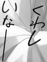
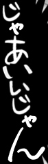
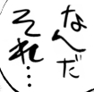
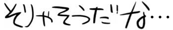
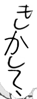
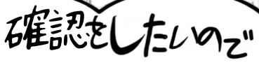
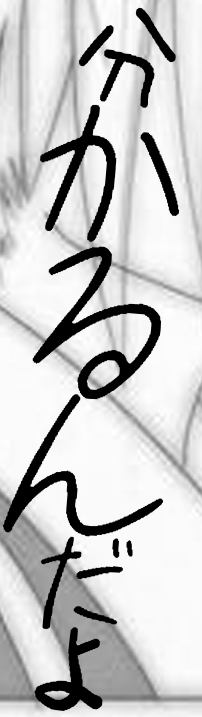
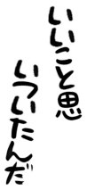
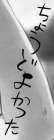
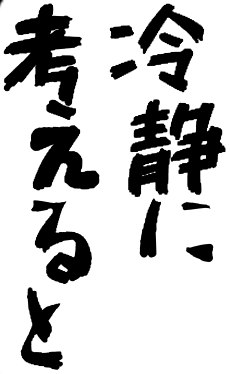

# 合成手写数据

[English](synthetic_handwriting.md) | [中文](synthetic_handwriting_zh.md)

manga-ocr-nar-small、manga-ocr-nar-small-distil 和 manga-ocr-base-CPT 的训练数据里有 1,670,000 张合成手写图片，占训练集 37.3%。本页说明我们的生成器怎样生成它们。生成器本身不公开，因为它围绕一份取自受版权保护漫画的文本语料构建。

## 样图

以下 10 张与训练集中的图片完全相同（从随机抽取的成品中挑选了较短的日常用语）。标签即训练目标。

| 图片 | 标签 | 图片 | 标签 |
|---|---|---|---|
|  | くわしいなー |  | じゃあいいじゃん |
|  | なんだそれ… |  | そりゃそうだな… |
|  | もしかして、 |  | 確認をしたいので |
|  | 分かるんだよ |  | いいこと思いついたんだ |
|  | ちょうどよかった |  | 冷静に考えると |

## 概览

每张图逐字拼出，而不是用一款字体一次排完一行：

1. **规划**：按固定配额抽出这张图的设定（文本长度、字高、横竖排、行数、场景、风格、分支）。
2. **文本**：从语料中选一行所选字体能完整画出的句子；按概率加标点或换一种符号写法。
3. **字形**：每个字单独用手写字体渲染；假名换成笔宽匹配的真实手写假名。
4. **排版**：沿手写感的行排字，字号、旋转、字距和行形状都随机，并处理标点、小假名和数字的规则。
5. **场景**：放进对白气泡或直接压在真实漫画背景上，裁切，再模拟印刷和图片压缩。
6. **检查**：任何字看不清、粘连过多或违反规则就丢弃重画；每批完成后由独立审计把存下的每张图重新检查一遍。

## 1. 素材

### 1.1 文本

- 来源：私有漫画收藏的文字（6,085 本，662,305 页）。生成器和语料因此都不公开；上面 10 张样图选的是较短的日常用语。
- OCR：用漫画文字/气泡检测器（ogkalu）切出文字框，以 [manga-ocr](https://github.com/kha-white/manga-ocr) 为老师识别。其中 12.0% 的框（4,765,926 个中的 573,953 个）另用 PaddleOCR-VL-For-Manga 识别一遍，按似然规则在两者中选一个；全部框中 97.8% 采用 manga-ocr 的结果。
- 清洗：用两个语言模型 OpenAI GPT-5.6 Luna 和 Terra，调用时不给工具，只给待判的文本。Luna 对每句提出保留 / 删除 / 修正；凡不是"保留"的提议都交给 Terra（high 推理）裁决，Terra 看得到整页文字；只有 Terra 判删才删除。只删明确的广告、制作署名、网站水印和汉化/扫图组残留；可能属于正文的一律保留（招式名、游戏 UI、拟声词、标题），拿不准的也保留。
  - 前 372,851 页在更早的一轮里按同样方式清洗过，当时的规则较旧，章节标题和技能/UI 标签也被删掉了。
  - 其余 289,454 页（2,064,508 句）：规则预筛直接保留 2,039,154 句；剩下 25,354 句交 Luna 判（每次 550 句），其中 18,199 句再交 Terra；最后的规则检查恢复了 Terra 判删的 1,658 句；共删除 8,659 句。
- 去重：4,412,517 个非空句中，去掉非日文、不含文字、括号不配对的句子，其余跨书去重为 3,325,673 个不同的句子，并记下每句的出现次数。
- 按书划分：587 本书的句子只用于验证集渲染，训练集渲染用其余部分。
- 每个长度档按固定随机顺序取前 N 行：1–4 字全取 162,157 行；5–8 字 292,000；9–16 字 198,000；17–32 字 76,000（共 728,157 行）。
- 规则过滤：删去广告残留、罕见拉丁词和罕见字（1,395 行）。
- 抽样权重：句子在来源中出现的次数；纯假名句再 × 2.2。只按出现次数抽时纯假名约占 47%，2.1 节参照框中为 61%，乘 2.2 后约 61%。
- 标签使用本项目的训练归一化（例如 `．．．` → `…`、`！` → `!`、`～` → `〜`）。源句最长 32 字。

### 1.2 字体

- 从作者网站收集免费日文手写字体（先收 51 款，后来补了几款），逐款记录来源和许可。不分发任何字体文件。
- 逐字检查轮廓是否为空：字体的字符映射表常列出它实际画不出的字，所以句子按字体真正能画的字来匹配。
- 目视筛选：保留清楚的日常手写，去掉草书、行书类毛笔字和装饰性过强的字体。
- 最终 42 个字体面，来自 29 款字体，分三组（日常 35、强调 6、特殊 1）。分组权重随风格变化（“注释”主要用日常组，“强调”多用强调组）。

  最终字体池：

  | 字体 | 作者 | 字体面 | 分组 |
  |---|---|---|---|
  | [仕事メモ書き](https://font.sumomo.ne.jp/shigoto.html) | Sumomomoji / Do-Font | 1 | 日常 |
  | [DartsFont](https://www.p-darts.jp/font/dartsfont/) | DAICHI / ProjectDARTS | 1 | 日常 |
  | [みちます](https://blog.masuseki.com/?p=197) | 桝田道也 / Michiya Masuda | 1 | 日常 |
  | [きろ字 / Kiloji](https://kironono.hatenablog.jp/entry/fonts-kiloji) | kilo | 4 | 日常 |
  | [851手書き雑フォント](https://pm85122.onamae.jp/851fontpage.html) | 8:51:22 pm | 1 | 日常 |
  | [Y.OzFont ペン字版 (おおがな YOz)](http://yozvox.web.fc2.com/82A882B782B782DF8374834883938367.html) | Y.Oz Vox | 5 | 日常 |
  | [Y.OzFont ペン字版 (こがな YOzakura)](http://yozvox.web.fc2.com/82A882B782B782DF8374834883938367.html) | Y.Oz Vox | 1 | 日常 |
  | [KFひま字](https://www.kfstudio.net/font/kfhimaji/) | sachie / KF STUDIO | 1 | 日常 |
  | [りいてがきN](http://aoirii.babyblue.jp/font/riitn/) | あおいりい | 1 | 日常 |
  | [TekitouPoem / 適当ポエム](https://github.com/Hagi42/TekitouPoem-Font) | Hagi42 | 3 | 日常 |
  | [ふい字](http://hp.vector.co.jp/authors/VA039499/) | ふい | 1 | 日常 |
  | [まきばフォント](http://hp.vector.co.jp/authors/VA039499/) | ふい | 1 | 日常 |
  | [あずきフォント](https://azukifont.com/font/azuki.html) | 日向梓 | 1 | 日常 |
  | [うずらフォント](https://azukifont.com/font/uzura.html) | 日向梓 | 1 | 日常 |
  | [あんずもじ2020](https://apricot.ciao.jp/site3-7.html) | 京風子 | 1 | 日常 |
  | [みかちゃん](https://mikachan-font.com/) | みかちゃん | 4 | 日常 |
  | [かずフォント](https://ikimono.uvs.jp/font/kazufont_menu.html) | かず | 1 | 日常 |
  | [かずフォント２](https://ikimono.uvs.jp/font/kazufont_menu.html) | かず | 1 | 日常 |
  | [Klee One](https://github.com/fontworks-fonts/Klee) | FONTWORKS | 1 | 日常 |
  | [kawaii手書き文字](https://font.spicy-sweet.com/) | spicy-sweet | 1 | 日常 |
  | [チルアウト / Chillout TYP](https://typingart.net/?p=471) | Typingart & Co. | 1 | 日常 |
  | [Azuki LB](https://azukifont.com/font/azuki.html) | 日向梓 | 1 | 日常 |
  | [Klee One SemiBold](https://github.com/fontworks-fonts/Klee) | FONTWORKS | 1 | 日常 |
  | [851チカラヨワク](https://pm85122.onamae.jp/851ch-yw.html) | 8:51:22 pm | 1 | 强调 |
  | [851チカラヅヨク](https://pm85122.onamae.jp/851ch-dz.html) | 8:51:22 pm | 2 | 强调 |
  | [りいてがき筆](http://aoirii.babyblue.jp/font/riitf/index.html) | あおいりい | 1 | 强调 |
  | [Yuji Boku](https://github.com/Kinutafontfactory/Yuji) | Yuji Kataoka / Kinuta Font Factory | 1 | 强调 |
  | [おつとめフォント](https://font.sleepcows.com/) | 何某亭 | 1 | 强调 |
  | [BR Wakaisho](https://github.com/BridgeRiver/BRWakaishotai) | BridgeRiver | 1 | 特殊 |

- 一款字体只有能画出整行所有字时才会用于这一行。只缺某个符号时整行换一款字体（最多 2 次）；文字本身从不混入后备字体。
- 极小字（低于 13 px）只用 13 个在该尺寸下仍清楚的字体面，汉字限 10 画以内。

### 1.3 真实手写假名

字体出自字体设计师之手，漫画里的手写不是。所以假名（不含汉字）部分取自真实漫画页面：

1. **候选页面**：[AnimeText-OCR](https://huggingface.co/datasets/JustANormalTinkerer/animetext-ocr)（固定版本）的裁图，用冻结 DINO 特征上的小分类器给手写外观打分。保留条件：手写分 ≥ 0.95、日文、OCR 置信度 ≥ 0.9、3–40 字且至少 2 个假名、短边 ≥ 18 px。只要手写的对白和旁注；不要拟声词，不要汉字。
2. **视觉模型裁字**：8 个相互隔离的 GPT-6.1 Sol 会话逐张查看源图，为每个假名选旋转角和框，再由确定性脚本切出像素（不重画）。各会话再看自己的联系图、改正错标（如 人 误作 ん、た 误作 せ、エ 误作 ユ、ぶ 误作 ぷ）；主代理和独立的 Sol 会话抽查。结果：1,201 张源图，4,843 个单假名，159 个标签（平假名 2,733、片假名 2,110）。
3. **去污**：Sol 去掉脏点和邻字残笔，方法只限于删除颜色分离后 alpha 中标出的分量；缺笔、错标或与邻字分不开的字隔离。4,475 个干净、368 个隔离。
4. **超分**：RealESRGAN_x4plus_anime_6B 放大 4 倍（先在试验集上对比了 SwinIR 2 倍、HAT 4 倍和轮廓平滑）。Sol 和主代理逐字对照来源检查放大结果，修掉伪影（假白芯、灰缝、残点），共修改 513 个。4,352 个通过、103 个观察、20 个隔离。
5. **人工审核**：作者在按字分组的网格页里审完全部 4,352 个字，剔除 62 个，剩 4,290 个。小 ぃ 没有可靠的原生样本，用 い 缩小得到（50 个），合计 4,340 项、159 个标签。
6. **扶正**：从斜着写的行里切出的字带有整行的倾斜。4 个 Sol 会话在源图上估计每一行或每一列的阅读轴（1,170 张源图），同一行的字一起旋转，使这一行变正，保留每个字自身的自然笔势。13 个没有可靠轴的字由作者手动定角度。旋转 2,940 个，保持不变 1,350 个。
7. **渲染时的使用**：只有笔宽与该行目标相差 1.35 倍以内的库内字形才会替换假名；一张图里所有正文字的笔宽相差不超过 1.65 倍。字形放大不超过原生裁图的 4 倍，否则用字体字形。

### 1.4 背景

- 101,079 张无字裁块，来自 [AnimeText](https://huggingface.co/datasets/deepghs/AnimeText)（固定版本，train）；其中 96,043 张用于训练集渲染，5,036 张用于验证集渲染。
- 每张源页：取标注文字框与文字检测框的并集，每个框外扩 max(16 px, 15%)，在剩余区域里找两边都 ≥ 192 px 的空白矩形（原生像素，不放大、不擦字、不补画）。每页最多 3 块。
- 拒绝条件：大面积平坦区（任意颜色的平坦连通区 ≥ 20% 或平坦矩形 ≥ 15%）；漫画文字检测器的任何命中（在裁块、旋转 90° 的裁块和 512 px 重叠窗口上各跑一遍）；贴着裁块边缘的孤立暗色笔触。
- 之后每块再由 GPT-5.6 Luna 会话目视检查（每次 4 张），看有无残字、拟声词和孤立标点，可疑就拒绝。另对白色笔迹做了一轮更严格的复查：复查 11,091 块，隔离 1,980 块。
- 与评测集 [JMangaBench_Read](https://github.com/muscgab/JMangaBench_Read) 的页面 ID（2,726 个）核对：无重合。

### 1.5 对白气泡

- 52 张带可写区域 mask 的气泡：28 张由 GPT Image 参照真实气泡生成（去掉文字、保留气泡边），再由作者挑选并伸缩到视觉上长宽均衡；17 张来自 manga-editor-desu（GPL-3，SVG）；4 张作者手绘；3 张程序生成。
- 形状包括椭圆、旁白框、云形、思考泡、爆炸、尖刺、多边形、心形等。有黑边 40 张、无黑边 10 张、黑底白字 2 张。
- 单个气泡在气泡样本中的占比不超过 1/26（3.85%）；超出的经三轮校准降权。

## 2. 生成一张图

### 2.1 规划的分布

每个维度都是对整批精确分配的配额（确定性打乱），而不是各自独立抛硬币：

| 维度 | 取值 |
|---|---|
| 文本长度 | 1–4 / 5–8 / 9–16 / 17–32 字：43.4 / 29.2 / 19.8 / 7.6% |
| 字高 | 8–96 px 共 16 档（8–15 px 合计 5.9%，15–33 px 43.6%，33–96 px 50.5%） |
| 方向 | 竖排 85%，横排 15%（配方可改） |
| 行数 | 随长度变化，例如 1–4 字：1 行 92%；17–32 字：1/2/3/4 行 3/50/37/10% |
| 场景 | 对白气泡内 80%，直接压在漫画背景上 20% |
| 风格 | 注释 35%、嘟囔 30%、强调 20%、情绪 15%（风格决定字体分组和行弯曲的强度） |
| 分支 | 配方 40%、限强 30%、自由 30%（见 2.3） |

长度和字高的分布按评测集候选池中 2,516 个真实非印刷文字框的边缘分布设定（GPT-6.1 Sol 判为非印刷，即手写、艺术字或混合的框；已排除评测集自身的页面和拟声词）。只用了这些汇总统计，从未使用这些图片。

### 2.2 文本改动

- **会改标签的添加**（重新计算标签）：插入逗号 14%、波浪线 10%、重复符号 4.5%、♪ 0.6%；加长波浪线 15%、超长省略号 1.7%。
- **不改标签的写法变化**（每组 10%）：同一内容换一种写法，例如 `!?` 与 `！？`、三点与两点的停顿、不同的长横线写法。省略号保留原有点数；5 点及以上画成占两格的长省略号。
- 爱心（♡）按图形绘制。

### 2.3 三个分支

- **配方（40%）**：从 15 个参考真实漫画手写写成的版式配方中选一个，例如“近直轴自然手写”“短句整体斜向”“单行柔弯与漂移”“平行多列与参差列尾”“紧凑密集字块”“少字疏松反应句”“细小长横排旁注”“短引子接长正文”“重复短词错位成组”。每个配方各自规定行数、方向和各项变化的强度。
- **限强（30%）**：2.4 的变化因素自由抽取，但最多 2 项达到最强档，强档字号变化与其他强档互斥。
- **自由（30%）**：同样的因素，不设上限。

### 2.4 随机变化因素

每个因素先按各自概率决定是否开启，再抽 1–5 档强度（1/2/3/4/5 档概率 6/24/40/24/6%；字的旋转、行角度等因素另抽方向）：

| 因素 | 开启 | 改变什么 |
|---|---|---|
| 字号 | 90% | 沿行平滑变化的字号趋势加逐字抖动（5 档约 ×0.89–1.37） |
| 字的旋转 | 88% | 缓慢倾斜趋势加噪声，顺时针或逆时针（5 档 8–12°） |
| 字的斜切 | 70% | 字形向右或向左斜切，重复字之间略有差别（5 档 14–15°） |
| 长宽比 | 82% | 字变窄或变宽（5 档 ×0.75–0.83 或 ×1.20–1.31） |
| 行形状 | 85% | 经过 4–10 个节点的随机游走曲线，RMS 0.10–0.18 em（15% 更强） |
| 整体角度 | 90% | 整段旋转，以小角度为主（1 档占 55%） |
| 行角度 | 55% | 各行独立倾斜 |
| 字距 | 90% | 更松或不规则的字距，带持续的节奏（窄 / 常规 / 宽） |
| 列 | 75% | 列距更松，起点错落 |
| 词组强调 | 18% | 一个 2–10 字的词放大 ×1.34–1.50 |
| 附加符号 | 75% | 文本旁的小尾标，如 ♡ ! ? |
| 符号 | 72% | 长横线、波浪线、省略号的长度和粗细 |
| 标点旋转 | 60% | 标点旋转 15–40° |
| 标点间距 | 85% | 停顿后和闭括号前的空隙 |
| 容器 | 80% | 把文本放进气泡的可写区域 |
| 裁切 | 95% | 最终裁切的边距：紧 / 松 / 偏左 / 偏右 |
| 成像 | 70% | 模糊 σ 0.15–0.4、亮度对比度小幅变化、缩小 ×0.85–0.98 |

### 2.5 排版

- **分行**：断点优先落在标点处，并兼顾各行长度均衡。单行、双行和多行使用紧凑、同向斜排、错落、沿轮廓、尾部扇开、局部强调等模板。视风格不同，30–90% 的行沿不规则的手写曲线排列，而不是直线。
- **版式路线**：常规 60%、双块 20%（主块加一个缩小到 ×0.78–0.92 的副块，常向相反方向倾斜）、单个低角度转弯 20%（行内 15–25° 的转折）。后两种需要文本够长，所以成品中双块约占 6%。
- **字的接触**：最多 3 对相邻字可以轻微相碰，像快写时那样；相邻字之间的墨迹空隙有上限，行不会散开。
- **笔**：每张图一个目标笔宽；强调可加粗到 ×1.6；笔压在整段上平滑变化（×0.7–1.4）。
- **漫画排版规则**：
  - 竖排中 2 位数字和拉丁字母、`!!`、`!?` 横排在一格内（纵中横）；3 位数字一半情况这样处理；
  - 小假名（ゃゅょっ…）在格内偏移，大小不超过正常假名的 82%；
  - 竖排使用括号和长横线的竖排字形；
  - 省略号居中占一格；行尾的 `!!` 或 `!?` 有 5% 竖着叠放。
- **极小字**（低于 13 px）：版式更简单、角度更小、字距更宽、对比度要求更严。

### 2.6 场景与成像

- **气泡内（80%）**：选可写区域与文本长宽比相符的气泡（最多 6 个候选），再围绕文字裁切，使背景露出 1.5–7.5%（15% 的情况露出 10–30%）。10% 的气泡紧贴字墨拟合（最多旋转 ±25°，并拉伸）。
- **直接压在背景上（20%）**：97% 在明亮区域写深色字，3% 在难的区域（包括白字）；过于平坦的裁块会被拒绝。
- **白色衬底**：背景会干扰文字时在字后加白：柔边描边（70%）或沿字形的大块白底（30%）。
- **墨色**：87% 的图为纯黑，其余为亮度 3–50 的深灰或深棕，按真实参照框中最暗墨色的分布设定。
- **编码**：按 4 倍分辨率渲染后缩小；存为 PNG（23%），或 JPEG，质量 96–100（56%）、84–88（30%）、89–95（11%）、60–83（3%）；小字质量不低于 92。

## 3. 检查

### 3.1 每张图的自动检查

任何一项不通过，就丢弃这张图并换种子重画（最多 160 次）：

- 每个字与身后背景的对比度足够（整段和逐字两级）；
- 单字重叠 ≤ 10%，总重叠 ≤ 4%；接触只限上文允许的情况；
- 正文字高不低于规划字高档下限的 75%，可见墨迹高于下限；
- 全图笔宽一致；
- 标点后和相邻字之间的空隙保持张开；
- 行内没有超过上限的空隙；
- 阅读顺序、逐字归属 mask 和标签与画面一致。

有些失败会就地修复而不是从头重来：给超出尺寸预算的那个假名换字体、去掉一对相碰的字、撤销一对字的紧排、重新排两块。用最终配置渲染的 1,160,000 张图里共重试 122,710 次（每张 0.11 次）；最常见的原因是笔宽不一致（37,153）和紧排字之间空隙不足（30,784）。

难的样本会被重试，所以成品会略偏向容易的样本。我们在较早的版本上重放了每张图的第一次尝试：纯假名句第一次尝试 61.8%、成品 62.0%；含标点的句子 53.0% 对 54.7%；字体构成相差 4.7%（总变差）。

### 3.2 独立审计

- 每个 50 张的分片完成后，独立审计重新读入存下的 PNG 和 mask，重算各项检查；不通过的图重画（最多 3 轮）。
- 每批完成后再对全部图片做一次终审。
- 保留了审计记录的批次（前 800,000 张的 80 批和最后一台机器的 116 批）全部通过终审，替换 0 张、丢弃 0 张；另外 14 批的记录没有保留。
- 每批记录全部代码、配置、字体、语料、背景和气泡清单的 SHA-256。同一种子逐字节复现同样的图片，我们据此验证了并行方式不会改变输出。

### 3.3 与真实手写的对比

- **几何**：长边、长宽比、行数和横竖排比例与 2,516 个真实非印刷参照框分桶比较。剩余的小差异已接受；例如高大于宽的框，我们的图占 74.0%，参照框占 83.2%。
- **图像统计**（较早版本，1,000 个参照框）：区分真实与合成裁图的小 CNN（5 折）AUC 0.63，基于 5 个色调统计量的逻辑回归 0.81。把墨色调到与参照一致后，只用色调的 AUC 降到 0.64，剩余差异在背景（纯白像素更少、纸面纹理更多）。这些检验较弱，用来找差异，不作为通过标准。
- **“哪里看着不对”的排查**对照参照框做出了具体修正，例如：词中断行、爱心太少、气泡背景露出过多或过少、纵中横竖叠过多、纯黑墨色过多或过少。

### 3.4 目视检查

- 生成器在三周内迭代了约 170 个版本。改动依据样张判断，样张由作者和 AI 审阅者目视检查。
- 作者审核了字体池、全部真实假名字形和手动角度；气泡和背景规则根据作者的意见修改过。
- 投产前，一份整条生产链的书面说明由独立审核（Claude）逐行对照代码和远端机器核对，发现的错误都已改正。
- 投产后随机抽查了 250 张成品。

## 4. 生产

- 1,670,000 张，分 167 批、每批 10,000 张，各用独立种子，在 5 台机器上渲染并逐批上传。
- 同一配置、两个代码版本：先 800,000 张，修复一个罕见崩溃后再 870,000 张。崩溃来自 OpenCV 边缘检测的一个破坏内存的问题；修复是让这个函数不走 SIMD，不改变任何输出。崩溃过的批次用原种子重跑并完成。

## 5. 局限

- 没有单独测量这部分数据的贡献（没有做有它和没有它的训练对比）。
- 只有假名有真实手写字形；汉字、拉丁字母和符号都来自字体。
- 语料是 OCR 结果。清洗针对的是非正文，不是识别错误，所以部分标签保留了老师模型的 OCR 错误；图片按同一文本渲染，图片与标签仍然一致。
- 用于设定分布和对比的参照框由语言模型（GPT-6.1 Sol）标注，不是人工标注。
- 重试使成品略比规划容易（见 3.1）。
- 背景裁块来自单一数据集（AnimeText），风格范围受其限制。
- 语料没有按评测集标签去重：对上一版语料的检查中，JMangaBench_Read v1.2 的 3,135 条标签文本有 546 条也出现在语料里，几乎都是常见短语（5 字及以上 130 条，10 字及以上 1 条）。
- 竖排中少数横线类符号画成了旋转后的样子，标签仍是横线写法。这在本批数据生成之后已在生成器中修复。
